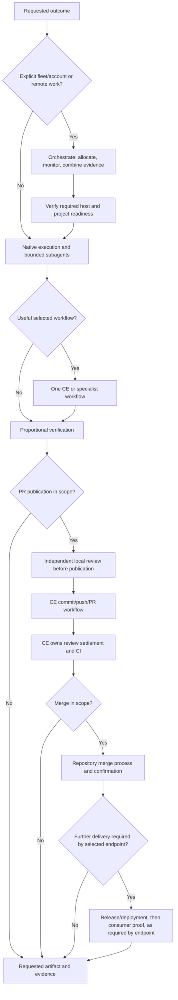

# Native work, selected workflows, and fleet orchestration

Routine work uses the harness's native tools and bounded subagents. Compound
Engineering (CE) provides focused workflows and external implementation
engines. Use Railyard for the delivery endpoint or explicit fleet coordination.

## Choose the smallest useful path

| Situation | Path | Completion boundary |
| --- | --- | --- |
| Known edit, bounded implementation, or routine investigation | Native tools; delegate independent subtasks when useful | The requested result and proportional checks |
| Planning, debugging, review, or UI work that benefits from a focused workflow | Invoke the matching CE or specialist skill | The requested artifact or verified behavior |
| One chat coordinating code changes across different engines | Separate `ce-work` runs with a named engine and bounded scope for each | The owning chat integrates and verifies the combined result |
| Create a PR or push user-requested commits to an existing PR | `compound-engineering:ce-commit-push-pr` | The requested PR state, with the selected CE workflow owning follow-through |
| Address PR feedback or watch CI | Applicable CE feedback or babysitting workflow | One owner for review settlement, CI, and the watch loop |
| Implementation or fix | Native or selected CE implementation, local review, and CE settlement | Confirmed merge, with further release and consumer verification when required |
| Explicit fleet/account allocation, remote work, or coordination that needs `orchestrate` | `railyard:orchestrate` | Combined acceptance evidence from the selected lanes |
| Fleet setup or reconciliation | `roundhouse:fleet-readiness` | Required host, project, tool, and authentication readiness |

`deliver` coordinates one requested outcome. It may execute directly or select
a focused CE workflow; it does not send generic implementation through LFG by
default. LFG remains available when explicitly chosen. Plan-only, diagnosis-only,
review-only, local-only, and PR-only requests retain their stated endpoints.
An implementation or fix request runs through confirmed merge when standing
delivery authority covers it. Narrower approvals and repository holds take
precedence.
A shipping request or repository requirement can also include release or
deployment and consumer verification. Follow the repository's merge queue
where configured. For a direct merge, verify the reviewed head, required
checks and approvals, and review-thread resolution before merging. Confirm
that the PR landed.

## Coordinate external implementation

For a bounded code change, assign the implementation engine to `ce-work`.
Each run binds one engine. A coordinating chat can assign disjoint changes to
different engines using separate runs and keep the combined review and
publication with `mode:return-to-caller`. Check prerequisites and report the
actual route. [Work across harnesses](../site/src/content/pages/what-it-does/work-across-harnesses.md)

## Keep one workflow owner

When CE is selected, it owns its planning or implementation workflow and its
review, feedback-resolution, CI, and watch loop. Railyard carries the user's
requested endpoint and verifies the returned evidence. CE remains the sole watcher.

Before first publication, run repository checks and one independent local
review of the cumulative change. When feedback requires a repair push, review
the repair and its affected behavior. Repeat the broad review when the design
or risk changes materially or the original coverage is uncertain. Batch fixes
and push once per batch. After one shared automated repair batch,
newly raised minor findings default to follow-up issues. Resolve real blockers
in the PR. Thermos and deeper review remain available for higher-risk work.

Use `gh-stack` for related dependent PRs when useful; keep independent PRs
independent. Resolve missing tooling at the stage that needs it through its
supported manager.

## Native children and visible tasks

Native subagents are the default for independent bounded work inside the
current task. Give each mutable scope one writer and a clear validation
boundary; serialize shared-file integration and dependent changes. A task can
use several subagents without creating an orchestration framework.

Visible Codex tasks are user-owned. Create one only when the user explicitly
asks for a new task. Fleet or remote work must use a supported, authorized
placement surface; do not infer permission to create a visible task from the
presence of a saved project or fleet catalog. If the necessary placement
surface is unavailable, report that limitation without silently changing
provider, model, account, or host. SSH command execution alone is not a remote
agent.

Use clear task titles that follow the user's and repository's conventions.
Rename only when the material focus or resume state changes. Completion does
not imply authority to archive tasks, remove worktrees, or reap processes.
For macOS Codex recovery, use
[Agent Utilities](https://github.com/novotnyllc/agent-utilities/tree/main/plugins/agent-utilities/skills/cleanup-codex).

## Explicit fleet and account work

`orchestrate` owns allocation, placement, monitoring, dependencies, and combined
acceptance evidence when that coordination is needed. It uses Roundhouse to
verify the required project, saved-project capability, harness, plugins, and
authentication before remote dispatch. A checkout on disk alone does not prove
the destination can accept the task.

Roundhouse owns fleet inventory and reconciliation. Missing required readiness
becomes a prerequisite; it does not authorize silent installation or unrelated
machine changes. Cross-project work names an integration owner for each project
and keeps branch and working-tree ownership explicit.

## Source skills

- [`deliver`](../plugins/railyard/skills/deliver/SKILL.md)
- [`orchestrate`](../plugins/railyard/skills/orchestrate/SKILL.md)
